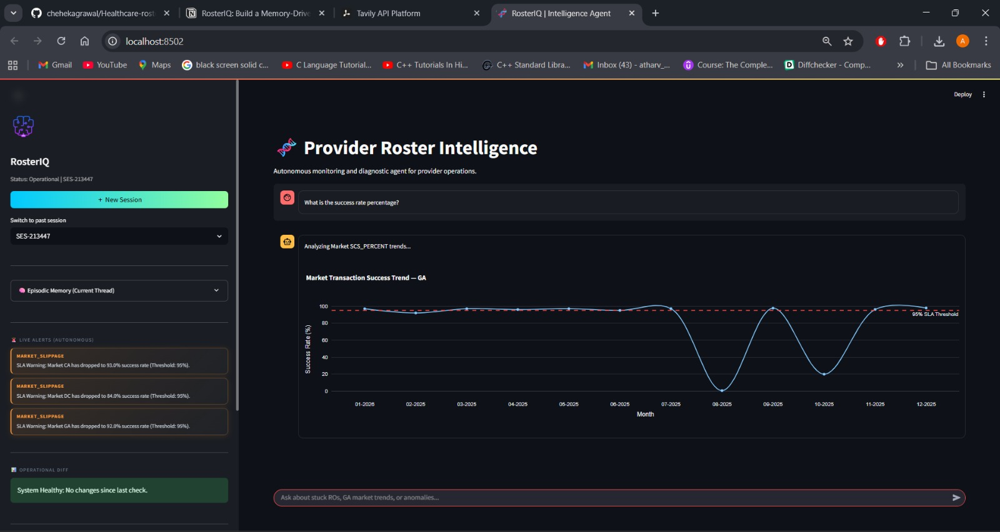
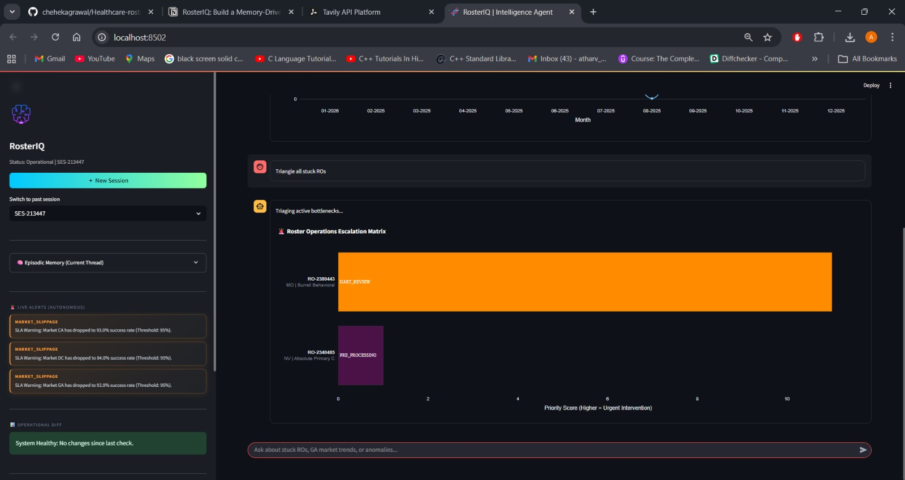
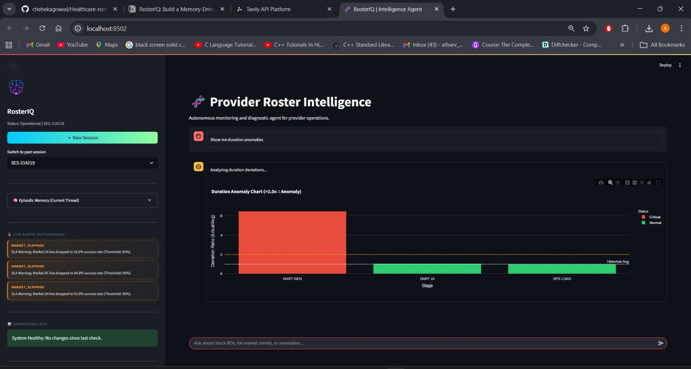
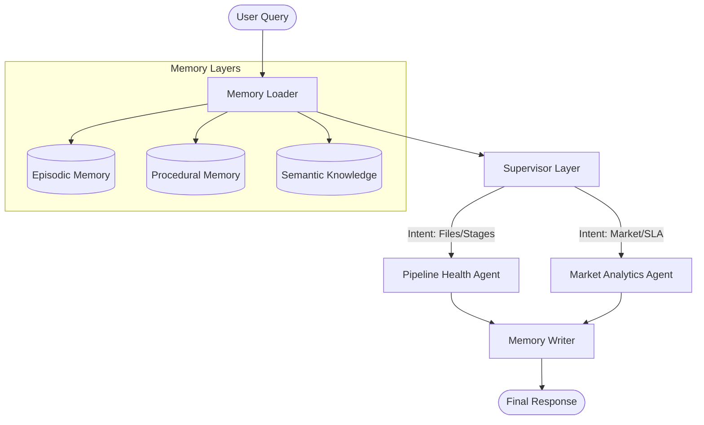
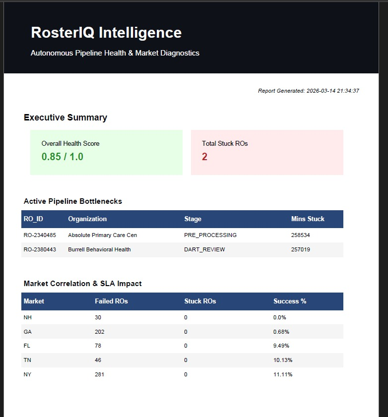

<div align="center">

# 🧬 RosterIQ
### Memory-Driven Provider Roster Intelligence Agent

[](https://python.org)
[](https://langchain-ai.github.io/langgraph/)
[](https://streamlit.io)
[](https://duckdb.org)
[](LICENSE)

*Autonomous AI agent for healthcare provider roster pipeline monitoring, anomaly detection, and cross-market analysis — with persistent, layered memory.*

**[Demo Video](PUT_DEMO_VIDEO_LINK_HERE)** · **[Report](./report.md)** · **[Architecture](#architecture)**

</div>

---

## 📋 Table of Contents

- [Overview](#overview)
- [Features](#features)
- [Architecture](#architecture)
- [Memory System](#memory-system)
- [Setup](#setup)
- [Running the Agent](#running-the-agent)
- [Example Interactions](#example-interactions)
- [Project Structure](#project-structure)
- [Environment Variables](#environment-variables)

---

## Overview

**RosterIQ** is an autonomous AI agent built for the HiLabs × Cognizance 2026 hackathon. It operates over two operational datasets — a **file-level pipeline dataset** and a **market-level transaction metrics dataset** — to help healthcare payer operations teams:

- Diagnose stuck Roster Operations (ROs) and pipeline bottlenecks instantly
- Correlate file-quality failures with market-wide success rate trends
- Remember every investigation across sessions and detect what changed
- Generate actionable reports and interactive visualizations
- Fetch regulatory context from the web when needed

> **The core innovation:** Three-layer persistent memory (episodic, procedural, semantic) that makes the agent smarter with every interaction.

---

## Features

| Feature | Description |
|---|---|
| 🧠 **Layered Memory** | Episodic + Procedural + Semantic — all persistent across session restarts |
| 🔍 **Pipeline Triage** | Auto-ranks stuck ROs by severity; detects duration anomalies (>2× historical avg) |
| 📊 **5 Chart Types** | Market trends, anomaly bars, health heatmaps, stuck RO tracker, retry lift |
| 🌐 **Web Search** | Tavily-powered regulatory & org context via natural language |
| 📄 **PDF Reports** | On-demand pipeline health reports, exportable as PDF |
| 🚨 **Proactive Monitoring** | Background scanner alerts on new stuck ROs / SLA breaches — no prompt needed |
| 🤖 **Multi-Agent** | Supervisor dynamically routes to Pipeline Agent or Market Analytics Agent |
| 🔗 **Root Cause Chaining** | Traces low SCS_PERCENT → orgs → source systems → pipeline stages |
| 📈 **Cross-CSV Analysis** | Links file-level health (CSV1) to market success rates (CSV2) |

### Key Features Spotlight

### Key Features Spotlight

| Market Health Heatmap |
| :---: |
| | Stage: Pre-proc | Stage: Mapping | Stage: ISF Gen | Stage: DART Gen | Stage: SPS Load |
| :--- | :---: | :---: | :---: | :---: | :---: |
| **GA** | 🟢 | 🟢 | 🟢 | 🔴 | 🟢 |
| **NY** | 🟢 | 🟢 | 🟡 | 🟢 | 🟢 |
| **TX** | 🟢 | 🟢 | 🟢 | 🟢 | 🟡 |
| **CA** | 🟡 | 🟢 | 🟢 | 🔴 | 🟢 |

_Systemic health visualization revealing stage-wide bottlenecks across CA, FL, GA, NY, and TX._

---

## 🖥️ Live Dashboard Interface

The RosterIQ interface is designed for high-density operational monitoring, providing clear visibility into complex provider data pipelines.


_**Main Dashboard**: Real-time overview of active Roster Operations (ROs). The sidebar provides persistent navigation and quick-access proactive alerts._


_**Memory-Driven Interaction**: The agent interface allows users to perform natural language queries. Notice the 'Memory Context' indicator, showing where current logic is being reinforced by Episodic or Semantic knowledge._


_**Visual Diagnostics**: Inline Plotly visualizations allow for deep-dive analysis of market trends and pipeline duration anomalies directly within the chat flow._


---

## Architecture

## Architecture


_High-level architecture showing the LangGraph multi-agent flow and memory-driven reasoning path._


### Agent Graph Flow

```
User Query
    │
    ▼
Memory Loader ──── injects context from all 3 memory stores
    │
    ▼
Supervisor (Gemini 2.0 Flash) ──── routes by intent
    │                   │
    ▼                   ▼
Pipeline            Market Analytics
Health Agent        Agent
    │                   │
    └────────┬──────────┘
             ▼
        Memory Writer ──── logs to episodic store
             │
             ▼
        Response to User
```

---

## Memory System

RosterIQ implements all three required memory types:

_Triple-layer persistent memory system architecture ensuring cross-session intelligence._

### 🗂️ Episodic Memory
Stores and retrieves the history of every interaction.
- **Backend:** SQLite (`roster_iq_memory.db`) + ChromaDB embeddings
- **Behavior:** On session start, compares current pipeline state against last snapshot → surfaces what changed
- **Example:** *"Last session you flagged 3 ROs stuck in DART_GEN in CA. 2 have resolved. 1 remains."*

### ⚙️ Procedural Memory
Stores and executes named diagnostic workflows.
- **Backend:** `procedures.json` (versioned) + ChromaDB for semantic lookup
- **4 Procedures:** `triage_stuck_ros`, `market_health_report`, `retry_effectiveness_analysis`, `pipeline_bottleneck_scan`
- **Improvable:** Users can update procedure parameters; the agent persists changes and bumps the version

### 🧬 Semantic Memory
Domain knowledge base of 600+ facts about the healthcare pipeline.
- **Backend:** ChromaDB
- **Coverage:** Stage definitions, FILE_STATUS_CD meanings, health flag logic, LOB abbreviations, SCS threshold definitions, CSV correlation patterns
- **Example:** Agent explains *why* it flagged an RO: *"DART_GEN_DURATION is 3× historical avg — typically indicates data volume spike or downstream validation bottleneck"*

---

## Setup

### Prerequisites

- Python 3.11 or 3.12 (recommended; 3.14 works with minor warnings)
- Git

### 1. Clone the Repository

```bash
git clone https://github.com/YOUR_USERNAME/Healthcare-roster-agent.git
cd Healthcare-roster-agent
```

### 2. Create a Virtual Environment

```bash
python -m venv venv

# Windows
venv\Scripts\activate

# macOS / Linux
source venv/bin/activate
```

### 3. Install Dependencies

```bash
pip install -r requirements.txt
```

### 4. Configure Environment Variables

```bash
cp .env.example .env
```

Edit `.env` with your API keys (see [Environment Variables](#environment-variables)).

### 5. Add the Datasets

Place the two CSV files in the `data/` directory:

```
data/
├── roster_processing_details.csv
└── aggregated_operational_metrics.csv
```

> The dataset link is shared privately with registered teams. Contact the organizers if you need access.

---

## Running the Agent

```bash
python -m streamlit run app.py
```

The app will open at `http://localhost:8501`.

> **First run:** The semantic memory will initialize with 600+ domain facts — this takes ~20 seconds. Subsequent startups are instant.

---

## Example Interactions

### Pipeline Triage
```
You:   Show me all stuck ROs and triage by severity
Agent: [Chart: Stuck RO Tracker] 2 ROs currently stuck.
       RO-2847 (DART_GEN, 3× avg duration, Red health) — CRITICAL
       RO-1923 (ISF_GEN, 1.4× avg duration, Yellow) — MONITOR
```

### Market Analysis
```
You:   Root cause analysis for TX
Agent: TX market SCS_PERCENT: 88.2% (below 95% SLA threshold)
       Root cause: 2 AvailityPDM ROs stuck in DART_GEN
       Org: MercyOne Medical Group — 3 failed first-iteration submissions
       Recommendation: Escalate RO-2847, review DART mapping rules for TX Medicaid
```

### Duration Anomaly Detection
```
You:   Show me duration anomalies
Agent: [Chart: Duration Anomaly Bar Chart]
       DART_GEN: 6.2× historical average — CRITICAL
       SPS_LOAD: 0.9× — NORMAL
       Semantic context: High DART_GEN duration typically indicates data volume spike
```

### Cross-Session Memory
```
You:   What changed since last time?
Agent: Since your last session (2h ago):
       ✓ 2 stuck ROs resolved (RO-1834, RO-2211)
       ⚠ GA market dropped from 91% to 87.3% SCS_PERCENT
       ⚠ New stuck RO detected: RO-2914 in DART_UI_VALIDATION
```

### Web Search
```
You:   What regulatory changes affect TX Medicaid providers?
Agent: [Web search: Tavily]
       Found: CMS updated provider roster submission requirements for FY2026...
       Relevance: May explain increased validation failures in TX LOB=Medicaid FFS
```

## 📊 Insights & Analytics Gallery

RosterIQ generates high-fidelity, actionable visualizations to guide operations teams.

| Duration Anomaly Detection | Market SCS Trend Tracking |
|---|---|
|  |  |

| Stuck RO Triage Tracker | Retry Effectiveness Analysis |
|---|---|
|  | [Detailed Metrics available in the PDF Report below] |

---

### Export Report
```
You:   Export pipeline health report
Agent: ✅ Report ready! [Download PDF]
```


_High-fidelity PDF report featuring executive KPI cards and zebra-striped bottleneck tables._

---

## Project Structure

```
Healthcare-roster-agent/
│
├── app.py                          # Streamlit frontend + routing logic
│
├── src/
│   ├── agent/
│   │   ├── graph.py                # LangGraph agent graph assembly
│   │   ├── nodes.py                # Agent node implementations
│   │   ├── state.py                # RosterIQState TypedDict
│   │   ├── monitor.py              # Background proactive monitoring
│   │   └── prompts.py              # LLM system prompts
│   │
│   ├── memory/
│   │   ├── episodic.py             # SQLite + ChromaDB interaction logging
│   │   ├── procedural.py           # Procedure registry + ChromaDB lookup
│   │   ├── semantic.py             # Domain knowledge base (600+ facts)
│   │   ├── change_detector.py      # Cross-session state diff detection
│   │   └── procedures.json         # Versioned procedure definitions
│   │
│   ├── tools/
│   │   ├── data_query.py           # DuckDB analytics wrapper
│   │   ├── visualizer.py           # Plotly chart generators (5 types)
│   │   ├── report_gen.py           # Markdown + PDF report generator
│   │   ├── root_cause.py           # Causal chain tracer (CSV1 ↔ CSV2)
│   │   └── web_search.py           # Tavily search integration
│   │
│   └── db/
│       └── duckdb_engine.py        # MetricsEngine wrapping DuckDB + CSVs
│
├── data/                           # CSVs go here (gitignored)
│   ├── roster_processing_details.csv
│   └── aggregated_operational_metrics.csv
│
├── tests/                          # Unit + integration tests
├── report.md                       # Full submission report
├── requirements.txt
├── .env.example
└── .gitignore
```

---

## Environment Variables

Copy `.env.example` to `.env` and fill in your values:

```env
# Required: Google AI Studio (Gemini API)
# Get your key at: https://aistudio.google.com/
GOOGLE_API_KEY=AIzaSy...

# Required: Tavily Web Search
# Get your key at: https://app.tavily.com/
TAVILY_API_KEY=tvly-...

# Optional: ChromaDB storage path (defaults to ./memory/chromadb)
CHROMADB_PATH=memory/chromadb
```

> **Never commit your `.env` file.** It is listed in `.gitignore`.

### Getting API Keys

| Key | Where to get it | Free tier? |
|---|---|---|
| `GOOGLE_API_KEY` | [aistudio.google.com](https://aistudio.google.com/) | ✅ Yes |
| `TAVILY_API_KEY` | [app.tavily.com](https://app.tavily.com/) | ✅ Yes (1000 searches/month) |

---

## Datasets

The two CSV datasets used by RosterIQ are proprietary operational data provided by HiLabs:

| Dataset | Description |
|---|---|
| `roster_processing_details.csv` | File-level pipeline data — one row per Roster Operation (RO), with stage durations, health flags, stuck/failed status |
| `aggregated_operational_metrics.csv` | Market-level monthly aggregates — SCS_PERCENT success rates, transaction counts per state |

> Access link shared with registered teams via the official hackathon channel.

---

<div align="center">

</div>
